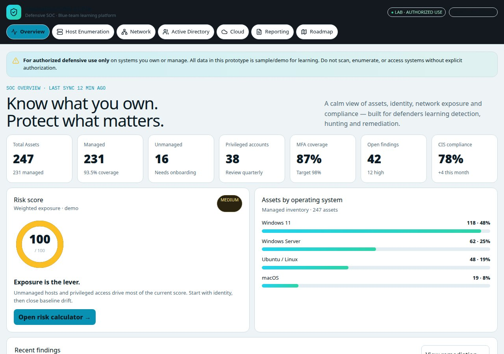
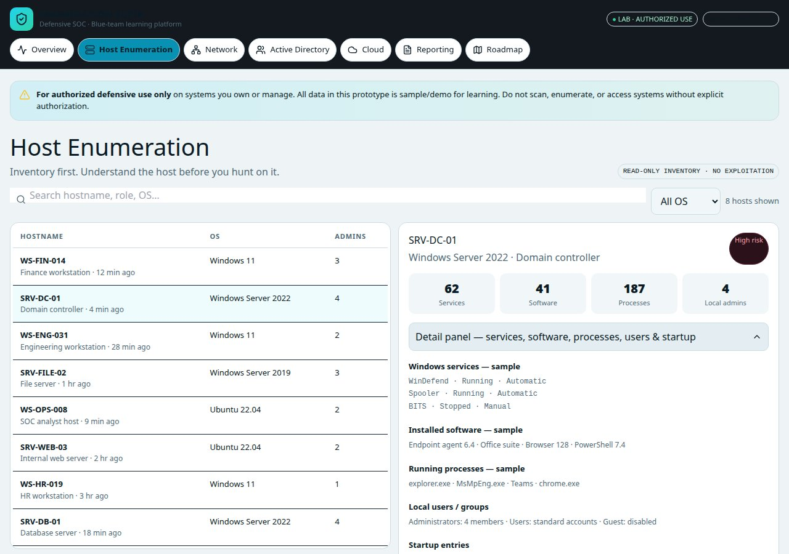
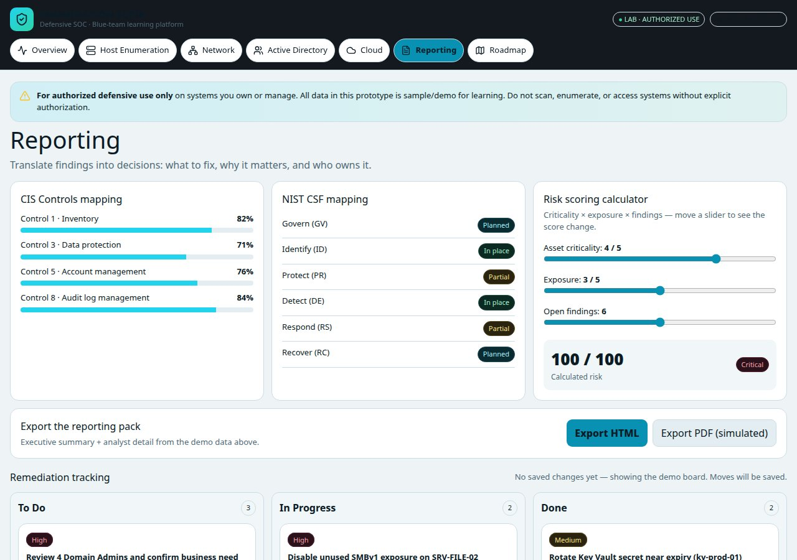

# Enumeration Suite — Defensive SOC Learning Platform (Prototype v0.9)

A defensive SOC blue-team learning platform in a single HTML file. It teaches asset inventory, host enumeration, network baselining, Active Directory review, and cloud configuration checks through a calm, read-only view of a fictional environment — with a risk calculator, a remediation tracking board, and an executive-summary export.

Everything is sample/demo data for learning. There is no live scanning, no connection to real systems, no real host data, and no backend. The app is for authorized defensive use only, on systems you own or manage.



## What it does

Seven tabs, all running on static demo data in the browser:

- **Overview** — asset counts (247 assets, 231 managed), MFA coverage, CIS compliance, a risk-score dial, assets by operating system, and a recent-findings table.
- **Host Enumeration** — 8 demo hosts with a search box and OS filter, a host detail panel (services, software, processes, local users/groups, startup entries), and 5 defensive, read-only PowerShell inventory commands with copy buttons.
- **Network** — approved-subnet discovery table with pass/fail validation against a baseline, plus DNS inventory, DHCP scope review, and open-port validation cards.
- **Active Directory** — privileged-group membership, stale and disabled account counts, MFA coverage, and a Kerberos & delegation review checklist.
- **Cloud** — Azure subscription inventory, Entra ID roles, Key Vault inventory, Conditional Access policies, and a storage-account public-access check.
- **Reporting** — CIS Controls and NIST CSF mappings, a risk scoring calculator (asset criticality, exposure, open findings), HTML executive-summary export, and the remediation tracking board.
- **Roadmap** — five planned stages from inventory to a full defensive platform, each marked In progress or Planned.



## The remediation board

The Reporting tab carries a 7-task remediation board (To Do / In Progress / Done). Moving a card saves it in the browser via `localStorage` (key: `enumeration-suite-remediation-v1`), so moves persist across page reloads on the same browser. Clearing browser storage resets the board to the demo seed state. Nothing leaves the browser: there is no account, no sync, and no server.



## How to run

Open `index.html` in any modern browser, or serve the folder with any static file server (for example `python3 -m http.server`). No build step, no install, no internet connection needed.

The file is fully self-contained: React, Tailwind CSS, icons, and all demo data are inlined. It makes zero external network requests (verified at runtime — see [TEST-REPORT.md](TEST-REPORT.md)).

## What this is not

- **Not a scanner.** Nothing here probes, enumerates, or touches a real network or host. The PowerShell commands are read-only inventory commands for your own authorized systems, shown as text to copy.
- **Not real data.** Every host, count, finding, and score is invented demo data for learning.
- **Not a compliance tool.** The CIS and NIST mappings are illustrative demo content, not an audit or certification.
- **PDF export is simulated.** The "Export PDF (simulated)" button says so in the UI and tells you to use the HTML export. The HTML export downloads a real static summary file built from the demo figures.
- **Not a penetration test target.** The [security audit](SECURITY-AUDIT.md) is a static review plus a runtime behavior check of this client-side-only demo — there is no live system behind it to test against.

## Honest limits

- The Overview risk dial shows the computed score (100/100 at the default slider positions), while the "MEDIUM" chip next to it is hardcoded demo text. The Reporting calculator shows the computed score and its matching label.
- The browser tab title is "React Artifact," carried over from the artifact the file was compiled from.
- Board state lives only in the browser that saved it. There is no sharing, no history, and no undo beyond moving a card back.

## Screenshots

| Tab | Capture |
|---|---|
| Overview | [01-overview.jpg](screenshots/01-overview.jpg) |
| Host Enumeration | [02-host-enumeration.jpg](screenshots/02-host-enumeration.jpg) |
| Network | [03-network.jpg](screenshots/03-network.jpg) |
| Active Directory | [04-active-directory.jpg](screenshots/04-active-directory.jpg) |
| Cloud | [05-cloud.jpg](screenshots/05-cloud.jpg) |
| Reporting | [06-reporting.jpg](screenshots/06-reporting.jpg) |
| Roadmap | [07-roadmap.jpg](screenshots/07-roadmap.jpg) |
| Mobile (400px, Overview) | [08-mobile.jpg](screenshots/08-mobile.jpg) |

## Stack

Single-file HTML. React 18.3.1 and Tailwind CSS v3.4.18 compiled and inlined, Lucide icons inlined, no CDN, no backend, no build tools, no dependencies to install. The only browser storage used is `localStorage` for the remediation board.

## Project structure

```
enumeration-suite/
├── index.html          # The entire app (polished copy; see POLISH-NOTES.md)
├── index.verbatim.html # The pasted file, byte-for-byte, kept as provenance
├── README.md
├── LICENSE
├── POLISH-NOTES.md     # Every change made to the pasted file, with reasons
├── TEST-REPORT.md      # Functional test results
├── SECURITY-AUDIT.md   # Static review + runtime behavior check
├── walkthrough-script.md
└── screenshots/        # Captured from the running app
```

## License

MIT — see [LICENSE](LICENSE).

Built by Robert Bostick. Part of a cybersecurity portfolio focused on defensive operations, detection, and remediation.
